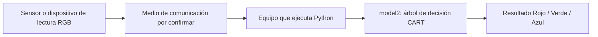

# Inferencia distribuida: clasificación RGB mediante árbol de decisión

**Asignatura:** Sistemas Inteligentes para Electrónica  
**Actividad:** Inferencia distribuida  
**Equipo:** Mateo, Jesús R. y Daniel 
**Estado:** Clasificador local disponible; comunicación distribuida pendiente de documentar con evidencia.

## 1. Resumen

Este repositorio reúne el código entregado por el equipo para clasificar lecturas **RGB** (rojo, verde y azul) utilizando un **árbol de decisión CART** construido en Python puro con el criterio de impureza **Gini**. El archivo principal es [`codigo/model2.py`](codigo/model2.py).


## 2. Objetivo

Clasificar valores RGB recibidos de un sensor o fuente de datos, mediante un modelo ligero que pueda integrarse en una arquitectura distribuida. Documentar el funcionamiento, los resultados de las pruebas y, cuando esté disponible, la comunicación entre el origen de datos y el equipo que ejecuta el modelo.

## 3. Modelo de inteligencia artificial

| Característica | Implementación |
| --- | --- |
| Tipo de modelo | Árbol de decisión CART |
| Criterio de separación | Índice Gini ponderado |
| Entradas | R, G, B, valores esperados en el rango 0–255 |
| Salidas | `Rojo`, `Verde` o `Azul` |
| Datos de entrenamiento | 15 muestras incluidas directamente en el código (5 por clase) |
| Entrenamiento | Se realiza al importar `model2.py` |
| Librerías externas | Ninguna para el modelo |

**Atención a la inversión del sensor:** el código original declara `_INVERTIR_SENSOR = True`, lo que transforma cada canal de entrada a `255 - canal` antes de clasificar. Por eso las salidas pueden parecer contrarias a los colores RGB directos. Se conserva esta opción original, pero su correspondencia con el sensor físico debe verificarse.

## 4. Arquitectura propuesta de inferencia distribuida



**Diagrama conceptual, no prueba de una conexión ya implementada.** El protocolo, el hardware y los códigos de emisor/receptor deben añadirse si fueron utilizados en clase.

## 5. Ejecución

Con Python 3 instalado, sin necesidad de instalar scikit-learn:

```bash
python codigo/model2.py
```

Para invocar la función desde un script propio:

```python
from codigo.model2 import model2
print(model2(170, 100, 95))
```

Con la configuración **original** `_INVERTIR_SENSOR = True`, el ejemplo devuelve **`Verde`** (comprobado ejecutando el archivo); el comentario final del archivo original dice `Rojo` y no coincide con la salida actual.

Para ejecutar el diagnóstico reproducible incluido en el repositorio:

```bash
python pruebas/prueba_basica.py
```

## 6. Estructura

```text
Inferencia-Distribuida-RGB/
├── README.md
├── codigo/
│   └── model2.py
├── pruebas/
│   └── prueba_basica.py
├── documentacion/
│   ├── algoritmo.md
│   ├── arquitectura.md
│   └── avances.md
└── evidencias/
    └── README.md
```

## 7. Evidencias solicitadas por el docente

- [x] Código del modelo de clasificación RGB.
- [x] Explicación del árbol de decisión y el uso del índice Gini.
- [x] Prueba básica reproducible del archivo original.
- [ ] Código del dispositivo que obtiene/envía los datos RGB (si se utilizó).
- [ ] Código de servidor o cliente y protocolo real (si se utilizó).
- [ ] Fotografías y capturas de la actividad en clase.
- [ ] Evidencia de la inferencia distribuida entre equipos.

## 8. Limitaciones

No se ha documentado una validación con conjunto de prueba independiente, una matriz de confusión, métricas de precisión ni desempeño frente a distintas condiciones de iluminación. Las 15 muestras están definidas manualmente en el código y no deben confundirse con una base de datos validada.

## 9. Documentación

- [Explicación del algoritmo](documentacion/algoritmo.md)
- [Arquitectura y comunicación pendiente](documentacion/arquitectura.md)
- [Bitácora de avances](documentacion/avances.md)
- [Cómo incorporar evidencias](evidencias/README.md)

Este repositorio se actualizará con el código completo utilizado en la práctica y resultados reales de las pruebas.
