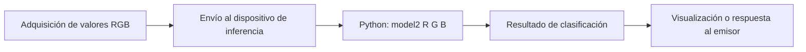

# Arquitectura de inferencia distribuida

## Alcance comprobable

El archivo `codigo/model2.py` **solo** incluye el clasificador local. Aunque un comentario menciona que se importa al iniciar Flask, el archivo **no** contiene rutas HTTP, configuración del servidor, lectura de sensor ni comunicación de red.

## Esquema conceptual

## Datos pendientes de recuperar de la práctica

1. Modelo del sensor y hardware utilizado.
2. Dispositivo que captura R, G y B.
3. Dispositivo donde corre `model2.py`.
4. Medio de comunicación real: HTTP/Flask, Wi-Fi, serial u otro.
5. Script del cliente/emisor y script del servidor/receptor, si existen.
6. Capturas de una solicitud y respuesta reales.

**No se debe presentar el esquema anterior como una comunicación implementada** hasta aportar ese código y la prueba de funcionamiento.
